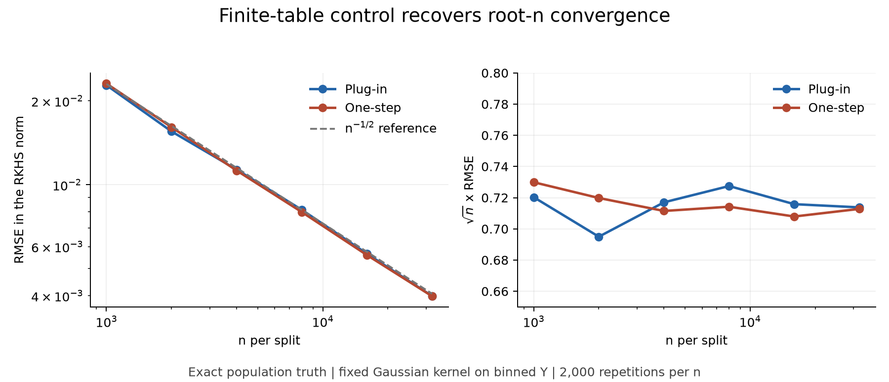
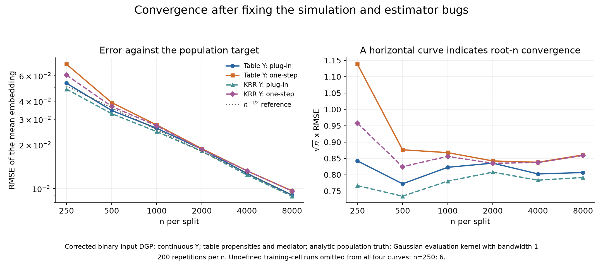

# Convergence audit

Start with the [short tutorial](../CONVERGENCE_FIXES.md) and
[file-by-file change inventory](CHANGES.md) for a compact owner-facing review.

Local audit of `Zamanke/FD-CME`, starting at commit `4a31f54` on
17 November 2026. Work is on `diagnosis/convergence-audit`; nothing has been
pushed. Existing result files and notebook outputs are historical and have not
been regenerated in place.

## Error log

This is a running log. **Confirmed** means there is a code-level reproduction
or direct evidence in saved files. Design limitations are listed separately.
Changes are deliberately kept separate from the standalone diagnostic scripts.

| ID | Status | Location | Finding and consequence |
|---|---|---|---|
| E01 | Confirmed; fixed in all seven DGPs | `DGPs.py` | A key is used for sampling and then split to generate the next variable. The binomial sampler itself uses a child key which is then reused for Gaussian noise. This creates strong dependence between structural noises and invalidates the intended causal model. All seven original generators fail the key-reuse checker; all corrected observational and intervention paths pass. |
| E02 | Confirmed; fixed | `convergence_experiment.ipynb`, cell 2 | `pi_mat = dr_mat.at[...]` overwrites the accumulated plug-in results with the one-step array. Only the final plug-in entry survives. |
| E03 | Confirmed; fixed | `embeddings.py`, both `explicit_m` branches | Mediator feature values use `A_kernel`, hence `sigma_A`, instead of `M_kernel` / `sigma_M`. The KRR outcome ablation can have a nonvanishing plug-in bias. |
| E04 | Confirmed; fixed | `nuisance_convergence.ipynb`, cells 9 and 10 | Computation is indented under the logging condition `k % 50 == 0`. Only four seeds run; 196 entries remain zero. |
| E05 | Confirmed; fixed | `nuisance_convergence.ipynb`, cell 7 | `conditional_DGP` expects a length-three vector but receives `(1,3)`. JAX clips the out-of-range row indices; the reference has shape `(10000,3)` instead of `(10000,1)`, with the wrong means. Broadcasting hides the dimensional mismatch in the kernel. |
| E06 | Confirmed; fixed | `utils.py`, `Learner` | Undefined annotations `Integer` and `Float` prevent a clean Python import. Replaced with `int` and the existing `Scalar` alias. |
| E07 | Confirmed; fixed | `convergence_experiment.ipynb`, cell 0 | Imports `plot` from `experiments`, but no such function exists. Removed the unused import. |
| E08 | Confirmed; not changed | `propensities.py`; `embeddings.mu_y_amx` | Empty table cells are not handled consistently: probability prediction divides by zero, while the outcome embedder silently uses a zero embedding. One-step weights can be NaN. A smoothing/backoff policy would be a statistical change, so the diagnostics count and report failures explicitly. |
| E09 | Confirmed; not changed | `root-n-consistency.ipynb` | Calls DGPs with the removed `confounding=` keyword. The current API exposes `u_scale`. This older notebook cannot run from a clean kernel as written. |
| E10 | Confirmed; not changed, outside convergence fix | `DGP_high_dim_M`, `DGP_high_dim_MX`, `DGP_high_dim_Y` | `null=True` sets `k=0`, but `5*A*X**2` remains in the mediator equation. The null still has a treatment effect. With shared independent noise, paired intervention outcomes differ by as much as 213.8 in the small test; the other four DGPs give exactly zero difference. Proposed separate fix: multiply this treatment-dependent term by `k` as well. |
| E11 | Confirmed; not changed, outside convergence imports | `divergences.py` | `Learner` is used in evaluated annotations but never imported. `import divergences` raises `NameError` under Python 3.12 even after repairing `utils.py`. |
| E12 | Confirmed; not changed, minor | `KRR_utils.get_CV_splits` | Integer-sized equal folds discard `n % nfolds` observations, contrary to the docstring's claim that all indices are covered. With n=10 and three folds only nine distinct observations appear. The `nfolds=1` case also tries to concatenate an empty list. This is not an explanation for the large convergence plateau. |
| E13 | Confirmed; diagnostics use float64; main evaluator not changed | `embeddings.MMD_plugin`; square roots in `experiments.py` and notebooks | Float32 cancellation can make a mathematically nonnegative squared MMD negative. Comparing a sample against itself, n=31 and seed=6 gives -5.0664e-7; taking its square root produces NaN. This is a distinct source of missing results from empty probability cells. Prefer float64 and a documented small-negative tolerance, rather than silently dropping NaNs. |

## Evidence collected

### E01: generator dependence

Using the original generator with 50,000 observations, seed 7, and
`u_scale=0`, recover outcome noise as `Y-M-X`. Across the eight `(X,A,M)`
cells, the maximum absolute noise mean is **1.6968**, or **128.5 standard
errors** from zero. With independent keys it is **0.0160**, or **1.51 standard
errors**. The corrected generator passes `jax.debug_key_reuse(True)`; the
original raises `KeyReuseError` at `random_split`.

A minimal example of the old pattern, with a Bernoulli(0.5) draw followed by
Gaussian noise using the first split child, produces correlation **-0.8004**
(20,000 draws, seed 7). This is not ordinary simulation noise.

For the original binary DGP, the artificial dependence between mediator noise
and outcome noise violates the no-confounding requirement for the mediator to
outcome relation. Thus the front-door functional of the observational law need
not equal the simulated intervention law. An estimator can converge perfectly
to the former while having nonzero error against the latter.

JAX's [random-number guide](https://docs.jax.dev/en/latest/random-numbers.html)
requires fresh keys for independent random draws. In the installed JAX 0.4.38,
`_binomial_inversion` explicitly uses `split(key)[0]` for its first uniform
draw, explaining the collision with the generator's next normal draw.

The fix gives X, U, A, M and Y separate keys before sampling in all seven DGPs. Those
assignments are identical in observational and interventional runs, including
when the A draw is skipped.

### E02 and E04: saved results are corrupted

- `binary_tabular_v2.npy`: 2,399/2,400 plug-in entries equal the one-step entries,
  including matching NaNs. The only difference is the last entry.
- `binary_tabular.npy`: the same pattern in 799/800 entries. Its saved contents
  are inconsistent with the currently checked-in older notebook's assignment.
- `propensity_convergence.npy` and `embedding_convergence.npy`: 98% zeros;
  only seeds 0, 50, 100 and 150 were computed.

The existing figures should therefore not be used to infer plug-in or nuisance
convergence. Historical arrays are retained so these findings remain auditable.

### E03: kernel mixup

On a finite-support fixture with different A/M bandwidths (0.5 and 1.2), and
ridge penalty `1e-5`, the original plug-in has total mass **0.66524**, rather than
approximately one. Its largest category-probability error relative to the
fully tabular estimator is **0.20724** for treatment 0 and **0.17740** for
treatment 1. After the four-line kernel fix, errors are at most **1.4e-7**;
the remaining difference is the small ridge penalty.

## What has checked out

The fully tabular `compute_plugin_a0` and `compute_EIF_a0` agree with independent
probability-table sums to **2.3e-16** for both treatment values. The MMD routines
also agree with an independent finite-support quadratic form in float64.
No missing EIF term or sign error was found in this check.

The formulas checked are, with g(a,m,x)=E[phi(Y)|a,m,x],
h(m,x)=sum_a p(a|x)g(a,m,x), v(a,x)=sum_m p(m|a0,x)g(a,m,x), and
eta(x)=sum_m p(m|a0,x)h(m,x):

```text
plug-in = average_X eta(X)
one-step = average_eval [
    p(M|a0,X)/p(M|A,X) * (phi(Y)-g(A,M,X))
    + 1[A=a0]/p(a0|X) * (h(M,X)-eta(X))
    + v(A,X)
]
```

For finite inputs with positive cell probabilities, the plug-in is a smooth
function of empirical cell probabilities and cell feature averages. This gives
root-n estimation by the delta method (also for continuous Y with a bounded
kernel). The random-key issue breaks the equality between this estimand and
the intervention distribution; it does not refute that root-n argument.

There is no demonstrated missing factor of n in the ridge penalty: the CV code
and estimator both use `K + lambda*I`. Under that convention a fixed lambda
corresponds to normalized regularization lambda/n. Inserting an extra n only
in the estimator would change the convention and can introduce bias.

In a fully finite version of the intended binary DGP, bin Y at 0.5 and 1.5.
Use exact population probabilities, a fixed Gaussian kernel on categories
0, 1, 2, and 2,000 independent repetitions per sample size. Fitting log RMSE
against log n for n=1,000 through 32,000 gives:

| Estimator | Slope | Expected root-n slope |
|---|---:|---:|
| Plug-in | -0.49762 | -0.5 |
| One-step | -0.50678 | -0.5 |

Here n is the size of each split: plug-in uses n observations; one-step uses n
training plus n evaluation observations. Results are in `tabular_rates.json`.
There were 66/2,000 empty-cell failures at n=250 and 2/2,000 at n=500; no failures
at n>=1,000. Low-n summaries exclude undefined draws and are not used for the
reported slope. This experiment establishes the finite-table control, not the
general nonparametric rate of the KRR estimator.

## Experiment-design limitations to distinguish from code bugs

1. **Finite reference sample.** A fixed 10,000-observation intervention sample
   contributes its own error. Even a consistent estimator eventually plateaus
   when measured against it. Root-n error to the population and error to one
   finite reference sample are different quantities. For the corrected default
   binary DGP, analytic Gaussian-mixture truth removes this issue.
2. **Changing evaluation kernel.** MMD bandwidth is recalculated from training Y
   on every run. This need not destroy consistency, but a fixed kernel makes a
   convergence experiment more interpretable.
3. **Float32 and dense inverses.** JAX defaults to float32. The code takes explicit
   matrix inverses and subtracts several order-one terms to obtain small MMD
   squared. Numerical sensitivity needs to be separated from statistical error.
   The diagnostics use float64. Replacing inverses with solves is a separate
   proposed change, not yet applied.
   In addition, adding a `(1,q)` vector to its `(q,1)` transpose in the MMD
   cross-term builds an unnecessary q-by-q array before averaging. The value is
   algebraically correct, but scalar contractions would save substantial memory
   for the 10,000-observation truth sample.
4. **Tuning on the evaluation split.** When `params=None`,
   `run_convergence_experiment` learns hyperparameters from all 2n observations,
   including the one-step evaluation split. This violates the intended training
   / evaluation separation. The main notebook supplies precomputed parameters,
   so that wrapper path is not the source of its current failure.
5. **Unnecessary KRR work in tabular mode.** Even with `explicit_y=True`, the
   estimator constructs unused kernel inverses and may tune unused parameters.
   This makes the diagnostic much slower than the probability-table problem.
6. **Model definition.** `DGP_binary` has binary X, A and M but continuous Y,
   and its default `u_scale=0` removes the intended latent confounding. Bounded
   kernel cell means still allow root-n estimation; Y need not be discrete.
   A separate truly finite control is supplied above.

## Reproduction

From the repository root in PowerShell:

```powershell
.\.venv\Scripts\python.exe diagnostics\convergence_check.py audit
.\.venv\Scripts\python.exe diagnostics\check_randomness.py
.\.venv\Scripts\python.exe diagnostics\convergence_check.py parity
.\.venv\Scripts\python.exe diagnostics\convergence_check.py rates
.\.venv\Scripts\python.exe diagnostics\convergence_check.py continuous
.\.venv\Scripts\python.exe diagnostics\convergence_check.py plot
.\.venv\Scripts\python.exe -m unittest discover -s diagnostics -p 'test_*.py' -v
git diff --check
```

The continuous check uses the actual estimator and corrected DGP, fixed
evaluation bandwidth 1, float64, and analytic population truth. It is a small
smoke test (eight seeds per n), not a high-precision rate estimate.

| n per split | Plug-in RMSE | One-step RMSE | Undefined empty-cell runs / 8 |
|---:|---:|---:|---:|
| 250 | 0.05311 | 0.09714 | 1 |
| 500 | 0.03260 | 0.04186 | 0 |
| 1000 | 0.02273 | 0.02511 | 0 |

For comparison, before changing the generator, a fresh n=500, seed=7 run
against 3,000 samples from its own intervention generator gave MMD 0.22158
(plug-in) and 0.22936 (one-step), using the same fixed bandwidth 1. The scale
is consistent with the historical ~0.24 plateau; this comparison is a
reproduction of the failure, not a paired estimate of the exact effect size.

The local environment uses Python 3.12, JAX/JAXlib 0.4.38, NumPy 2.2.6,
SciPy 1.15.3, Flax 0.10.4, Optax 0.2.4 and scikit-learn 1.6.1. Tests here use
the table propensity method; this is not a claim of compatibility for every
classifier option in that older scikit-learn version.

## Suggested explanation order for reviewing the changes

1. Repair the clean-import blockers (two annotations and one unused import).
2. Repair the generator's key allocation and verify noise independence.
3. Repair the result-array assignment and check distinct fake outputs survive.
4. Repair the four mediator-kernel calls and compare against exact tables.
5. Repair nuisance-loop indentation and the conditional-reference input shape.
6. Review the standalone diagnostics and newly generated JSON separately.

The original result files cannot be repaired from their saved contents: most
plug-in values were overwritten and most nuisance repetitions never ran.
They require rerunning after reviewing the fixes.

The final checks passed: five regression tests (including all seven generators
in both observational and intervention modes), estimator/table parity for both
treatments, finite-support MMD parity, the independent 2,000-repetition rate
experiment, the corrected continuous-outcome smoke test, a fresh call through
`run_convergence_experiment` in float32, `pip check`, and `git diff --check`.
The historical result files remain untouched. The corrected binary experiment
has now been rerun over the full six-size, 200-seed grid, as described below.



## Full corrected binary-input sweep

Completed after the initial audit: 200 repetitions at n=250, 500, 1000, 2000,
4000 and 8000. This uses the actual corrected `DGP_binary`, continuous Y,
treatment a0=1, the default u_scale=0, and tabular propensity and mediator
estimation. The four curves compare plug-in/one-step with tabular/KRR outcome
embeddings. Here n is the size of each split: the plug-in uses the training n,
while one-step also uses the independent evaluation n.

The unchanged `learn_hyperparams` function fitted parameters once on 2,000
independent observations with seed 100000. Saved values, in the original
order, are [1.3277542162, 1.6254988233, 1.8762521184, 1.5557195282, 1.6246475517].
Exact values and fit metadata are in `fixed_sweep_params.json`.

For a clean convergence assessment, evaluation uses float64, a fixed Gaussian
kernel with bandwidth 1, and analytic population truth. These are deliberate
differences from the original notebook's changing median bandwidth and fixed
10,000-observation empirical reference. They remove reference-sample error and
make the metric identical across n.

To make the full sweep practical, `fixed_convergence_sweep.py` groups the eight
binary input combinations. KRR on repeated inputs reduces exactly to an 8-by-8
linear system; the production estimator functions are not rewritten. We
checked both treatment values, both outcome estimators, and both a deliberately
asymmetric bandwidth fixture and the actual fitted parameters. Observation
weights agree with the dense repository implementation to 1.03e-14.

The Gaussian MMD is evaluated with deterministic 192-node Gauss-Hermite Fourier
quadrature. Dense squared-MMD parity error is 3.51e-16; maximum kernel error on
a 10,001-point distance grid [0,20] is 2.96e-15. Target cross-term and norm
errors are below 7.1e-16. All observed |Y| values were below 6.918, inside the
checked range. Validation results are saved in `fixed_sweep_validation.json`.

Six n=250 training samples had empty cells (seeds 6, 84, 136, 156, 183 and 185).
These are explicitly excluded from all four curves and labelled on the plots.
All 200 runs succeeded at every larger n. Thus the n=250 summaries are
conditional on having nonempty cells; the slope fits use only n>=1000.

| Estimator | Log-log RMSE slope, n>=1000 | RMSE at n=8000 |
|---|---:|---:|
| Table Y, plug-in | -0.51434 | 0.009019 |
| Table Y, one-step | -0.50423 | 0.009622 |
| KRR Y, plug-in | -0.49830 | 0.008849 |
| KRR Y, one-step | -0.49818 | 0.009605 |

All four curves are consistent with root-n convergence over the larger sample
sizes. This validates this binary-input experiment, not all continuous or
high-dimensional experiments in the repository.

- `fixed_convergence_rmse.png` / `.svg`: RMSE and sqrt(n)-scaled RMSE.
- `fixed_convergence_mean_sd.png` / `.svg`: the original four-panel arrangement
  of mean, SD, sqrt(n)-mean and sqrt(n)-SD of MMD. Shading gives approximate
  95% Monte Carlo intervals for mean MMD, not observation-level uncertainty.
- `fixed_convergence_raw.npz`: individual MMDs; shape (6,200,4), missing runs
  stored as NaN rather than zero.
- `fixed_convergence_summary.json`: summaries, exclusions and configuration.

Reproduce from the repository root (the independent hyperparameter fit takes
several minutes; its saved result can be reused):

```powershell
.\.venv\Scripts\python.exe diagnostics\fixed_convergence_sweep.py fit
.\.venv\Scripts\python.exe diagnostics\fixed_convergence_sweep.py validate
.\.venv\Scripts\python.exe diagnostics\fixed_convergence_sweep.py run
.\.venv\Scripts\python.exe diagnostics\fixed_convergence_sweep.py plot
```

An optional `prepare` command caches the empirical cell feature means in an
ignored `.cache` directory. The cache is checked against the DGP source hash.

For a separate view of the KRR first stage for E[phi(Y)|M,A,X], use
`fixed_convergence_sweep.py plot_krr`. This reuses columns 2 and 3 of the same
200-repetition results and writes `fixed_krr_outcome_rmse.png` / `.svg` and
`fixed_krr_outcome_mean_sd.png` / `.svg`. The mediator embedding and both
propensities remain tabular; only the conditional outcome embedding is KRR.


